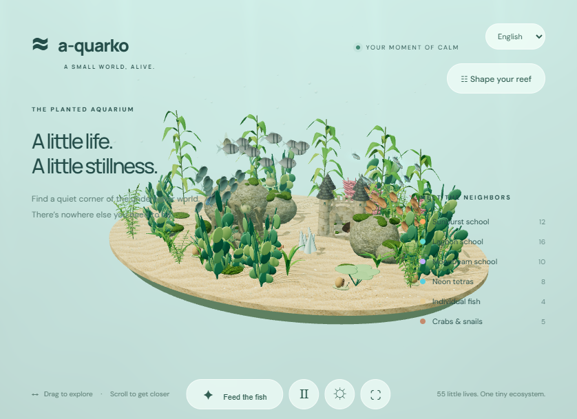

# A-quarko

A small toy-like WebGL aquarium built with Three.js. Includes a sand island, textured rocks, gently swaying plants, four fish schools, individual fish, crabs, and snails.

Run `npm run dev` and open http://localhost:5173. Drag to orbit, scroll to zoom, feed the fish, pause time, or toggle dark mode with the sun/moon button. The ⛶ button hides the header, intro text, legend, and other buttons for a distraction-free view, leaving only a back button to bring the overlay back.

Choose English or Čeština from the language menu. Czech covers the page, settings, status messages, accessible labels, and decimal formatting. Language and dark mode initially follow browser preferences, and explicit selections persist independently of reef settings. Resetting the reef keeps your language and appearance choices. Run `python tests/verify_preferences.py` against the local server to check them.

**Aquarium lighting** in the sidebar offers morning, daylight, sunset, and night. Each changes light color, direction, intensity, and water tint. Interface dark mode is independent of the chosen time of day. Neon tetras have emissive stripes and soft additive glow; choose blue, pink, or green and adjust glow from 0 to 2x. Night lighting enhances their glow. Their count is under Fish schools. Lighting choices save with the reef; resetting restores daylight. Run `python tests/verify_lighting.py` to check these controls. The glow is a lightweight sprite effect rather than full-screen bloom.

**Look & atmosphere** switches between the playful miniature and a simplified natural planted tank inspired by a home aquarium: rectangular substrate, dark stone backing, fine mixed gravel, driftwood, glass edges, natural fish colors, and flat sword-like leaves. Counts are preserved between styles, while each style keeps its own camera position during the session. Both views have a full-screen underwater gradient, softly moving shafts of light, depth haze, and suspended particles. Water atmosphere and speck density can be adjusted separately or turned off. These settings persist and pause with the scene. This is a simplified rendered aquarium, not a photorealistic reconstruction of the reference.

**Plant surfaces** independently chooses smooth playful leaves or natural leaf veins, fine bump detail, and roughness variation. **Match scene style** uses smooth plants for the miniature and textured plants for the planted tank. The generated leaf scan is neutralized at runtime so red and green species keep their colors. Flat ribbon plants, broadleaf plants, ferns, rotala, and lotus share the detail maps; leaf UVs follow each leaf's long axis. Switching surfaces preserves counts and animation, and never downloads textures again.

**Fish appearance** defaults to natural aquarium fish, with the original playful models available separately. Natural models have tapered bodies, generated scale detail, gill covers, small reflective eyes, thin ray-textured fins, forked or flowing tails, and species-specific markings: barb-like lateral stripes, rainbowfish lines, tetra bars, neon blue/red bands, angelfish stripes, marbled bettas, and smooth spotted puffers. Their fins animate independently, and neon stripes retain the glow controls. The species maps are built once and reused across fish and rebuilds. Counts, movement styles, feeding, and pause are preserved. These are stylized naturalistic models, not exact biological reconstructions. See `dist/assets/textures/README.md` for the generated scale asset and full prompt.

**Castle finishes** offers limestone blocks, aged red brick, weathered stone, or alternating masonry between castles. Roofs use generated slate shingles or terracotta tiles, with an option to alternate materials between towers. Walls have consistent world-scale texture mapping, while conical roofs have separate tile UVs, eaves and small finials. Finish selections persist and do not change castle counts. Existing ruins retain their rough stone finish.

Water ferns now use five gently arching fronds per clump, slender stems, and thin tapered leaflets with irregular alternating spacing. Leaflets vary in length, pitch and color and narrow toward frond tips. They use open double-sided surfaces rather than inflated ellipsoid leaves, and share the existing plant-surface texture and animation controls.

Three.js is vendored locally. The optional Google Fonts stylesheet requires internet; system fonts are used offline.

Use **Shape your reef** to adjust 26 varieties across ornaments, plants, rocks, moss, fish, and bottom dwellers. Counts update live, including zero, and are saved in browser local storage. Restore the default arrangement with **Restore original reef**. Escape closes the panel.

The Landscape section offers a quiet sand bed, rippled dunes, rolling hills, a rocky basin, and sunken terraces. Relief height ranges from 0 to 1.8x. The sand mesh, pebbles, planting, rocks, moss, and bottom dwellers follow the selected terrain. Fish keep clearance above the ground. Underwater treasures include mossy arch ruins with broken columns and small castles with towers and open gateways; their foundations extend into sloping sand. Terrain and ornament settings persist with the rest of the reef.

- Plants: broadleaf, fern, flat ribbon grass, ruby rotala, dwarf lotus, corkscrew stems, and tall ribbon kelp. Kelp has narrow tapered blades branching from slender stems; ribbon grass grows as flat blades from the sand. Both use folded double-sided surfaces with animated tip flutter rather than ellipsoid leaves. The plant animation follows pause and activity controls.
- Rocks: river stones, slate, lava stones, quartz clusters.
- Moss: cushion, carpet, marimo balls, branching Java moss.
- Schools: sunburst, lagoon, moonbeam, neon tetras. Select gentle cruise, meandering, or playful bursts.
- Individuals: angelfish glide, bettas wander with flowing fins, puffers hover then dart. Each follows its own route.
- Bottom dwellers: crabs scuttle with animated legs; spiral-shell snails crawl slowly along the sand.

Activity controls animation speed from 0.25x to 2x. Movement preferences are saved alongside counts. These are playful animations rather than biological simulations.

Sand, rocks, masonry, and moss use AI-generated color textures saved locally in `dist/assets/textures/`, with derived bump and roughness maps. Fish scales remain procedural. No external texture service is required at runtime. Full generation prompts and asset details are in `dist/assets/textures/README.md`. Run `python verify_editor.py` against the local server for browser checks (requires Playwright and Chromium), or `python tests/verify_materials.py` to check material loading and rendering.
